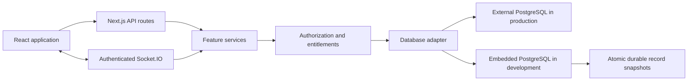

# Architecture

## One application, scoped resources

The Next.js App Router application and Socket.IO server share one Node process and database connection layer. The custom server is intentional: a conventional serverless-only deployment cannot maintain these Socket.IO connections. There are no unnecessary microservices.

The global identity is a `users` record. A membership is a composite of user, organization, role, and status. Privileges are scoped to that relationship. A person can own one organization and be an ordinary member of another.

## Authorization

- `permissions.ts` centralizes organization membership, conversation access, post visibility, and Bridge access.
- A single post visibility predicate is used by feeds, post details, search, reactions, comments, and file downloads.
- Organization-only content requires an active membership. Private community content additionally requires community membership. Joining an organization does not grant access to all private communities.
- A Bridge requires two different organizations, receiving-side approval by a different authorized administrator, active status, explicit Bridge membership, and a current membership at a participating organization.
- Closing a Bridge immediately denies shared feed and conversation retrieval.
- Conversations require explicit participation and current access to any enclosing organization, community, or Bridge. No client-requested arbitrary socket rooms are accepted.
- Realtime delivery checks both resource access and each receiving socket’s current session. Session revocation prevents later private emits.
- Subscription entitlements are checked on the server for private publishing, organization channel creation, Bridge creation/approval, and membership approval limits. Some wider storage/content entitlements remain incomplete; see the report.

Production administrative actions require an MFA-verified session. TOTP secrets use AES-256-GCM with a server encryption key; only setup secrets are exposed during deliberate enrollment. Codes are checked against RFC 6238, replay counters are locked transactionally, and recovery codes are hashed and single-use.

## Database

The canonical schema is versioned SQL. It includes foreign keys, composite uniqueness constraints, audience constraints, message idempotency keys, and indexes on feed ordering, memberships, participants, messages, notifications, and audit logs. Drizzle provides typed definitions and SQL generation for profile retrieval; more complex repository queries use parameterized PostgreSQL SQL directly.

Migrations run in filename order in a transaction and are tracked in `schema_migrations`. Production migrations should be applied once during release preparation, before starting the application.

The embedded development adapter serializes writes. It exports a consistent record snapshot, adds a checksum, syncs a temporary file, preserves the previous snapshot, and atomically renames the new file before returning success. Restart tests deliberately exit without calling close and verify that acknowledged records survive. An exclusive process lock prevents accidental concurrent access.

The local snapshot is appropriate for small development environments. It rewrites records on mutations and does not substitute for the external PostgreSQL adapter’s production performance, WAL, replication, and operational backup facilities.

## Messaging correctness

1. A client allocates a UUID idempotency key and preserves pending content in a user-specific local outbox.
2. The socket or REST entry point authenticates the user and rechecks current participation and permissions.
3. The message is persisted with unique `(sender_id, client_id)`.
4. Only persisted content receives a successful acknowledgment. A changed payload using an existing key returns a conflict.
5. Authorized recipients receive a real socket event. The client deduplicates by stored ID and sender/client ID.
6. Missed messages are reconciled from durable history after reconnection. History uses timestamp-and-ID cursors.
7. Read state is recorded explicitly. The UI distinguishes pending, failed, sent, and read. It does not invent delivery receipts.

Socket.IO ordering alone does not provide durable delivery; the persistence, idempotency, and history reconciliation above implement that additional behavior. See the [official delivery guarantees](https://socket.io/docs/v4/delivery-guarantees/).

## Operational boundaries

This release runs as one application instance. Multiple instances need a Socket.IO Redis adapter, a coordinated notification/outbox system, shared storage, migrations coordination, and load testing. Search is bounded permission-aware SQL, not a trained ranking model or vector AI assistant. Background jobs, digests, indexing at scale, and external AI are not silently simulated.
